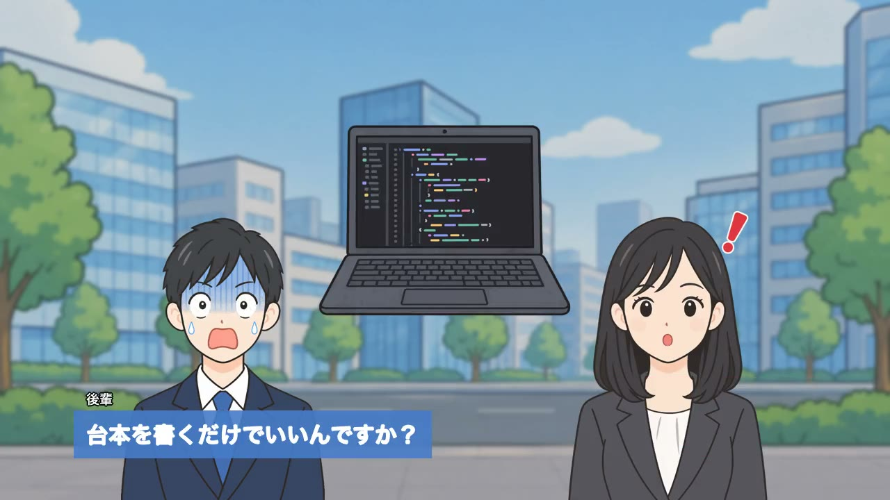

# daihon

**台本を書くと、解説動画ができる。**

`movie.yml` に会話を書いて `daihon build` を実行すると、VOICEVOX または macOS の `say` で音声を合成し、
立ち絵・字幕・画像を合わせた mp4 を書き出します。

[](docs/introduction.mp4)

▶ [紹介動画を見る](docs/introduction.mp4)（1分・1.3MB）。この動画も daihon で作っています。台本は [`examples/introduction`](examples/introduction/movie.yml) にあります。

```yaml
scenes:
  - id: timing
    script:
      - show: assets/images/stopwatch.png
        as: watch
        enter: fade
      - kouhai: "でも、声と字幕のタイミングを合わせるのが大変そうです。"
        expr: question
      - senpai: "そこがポイント。先に音声を作って、その長さで尺を決めるの。"
        expr: idea
      - hide: watch
```

## 特徴

- **秒数を書かない** — セリフの長さは合成した音声から決まります。画像・表情・字幕は
  すべて「行」に紐づくので、1行足せば以降のタイミングは自動でずれます。
- **台本はただのテキスト** — git で差分を見て、レビューして、CI で検査できます。
- **差分ビルド** — 音声は行ごとにキャッシュされます。1行直しても合成し直すのはその行だけです。
- **素材ゼロでも動く** — 立ち絵や画像が無ければプレースホルダで描くので、構成から先に作れます。
- **キャラクター非依存** — 本体は特定のキャラクターを持ちません。立ち絵と声は台本側のデータです。
- **単一バイナリ** — 動かすのに必要なのは ffmpeg と音声エンジンだけ。ブラウザや Node は要りません。

## クイックスタート

ソースからビルドします。Go 1.25 以降が必要です。

```bash
git clone git@github.com:takoikatakotako/daihon.git
cd daihon
go install ./cmd/daihon       # $(go env GOPATH)/bin に入る

brew install ffmpeg
docker compose up -d          # VOICEVOX ENGINE を使う場合

daihon init my-video && cd my-video
daihon build                  # out/movie.mp4 ができる
```

詳しくは [はじめての動画](docs/getting-started.md) を参照してください。

サンプルをビルドする場合:

```bash
cd examples/introduction
daihon build                  # out/introduction.mp4
```

## ドキュメント

| | |
|---|---|
| [はじめての動画](docs/getting-started.md) | インストールから書き出しまで |
| [movie.yml リファレンス](docs/movie-yml.md) | 台本の書き方、演出命令、書き出し設定 |
| [キャラクター](docs/characters.md) | 声・立ち絵・表情・口パク、素材の用意 |
| [コマンド](docs/commands.md) | `init` `doctor` `check` `voice` `timeline` `build` |
| [設計書](DESIGN.md) | 設計判断と実装ノート |

## 状態

台本から mp4 までひと通り動きます。

未実装: 立ち絵や画像のアニメーション、シーン間のトランジション、動画素材の埋め込み、
ブラウザプレビュー、macOS `say` 以外の追加音声エンジン（[DESIGN.md §9](DESIGN.md)）。

## ライセンス

MIT。`examples/introduction` の画像（ChatGPT で生成）も同じく MIT です。

ffmpeg は外部プロセスとして呼び出すだけなので、そのライセンスは本体に伝播しません
（DESIGN.md §5.1）。音声エンジンや、自分で用意した立ち絵・BGM の利用規約は、
それぞれの配布元に従ってください。VOICEVOX の音声を使った動画にはクレジット表記が必要です。
